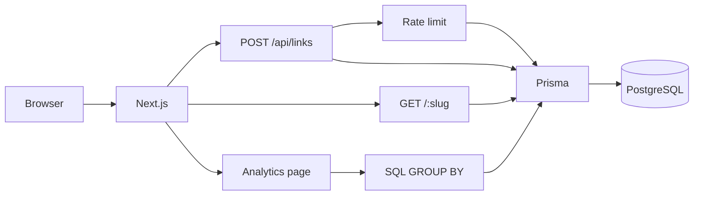
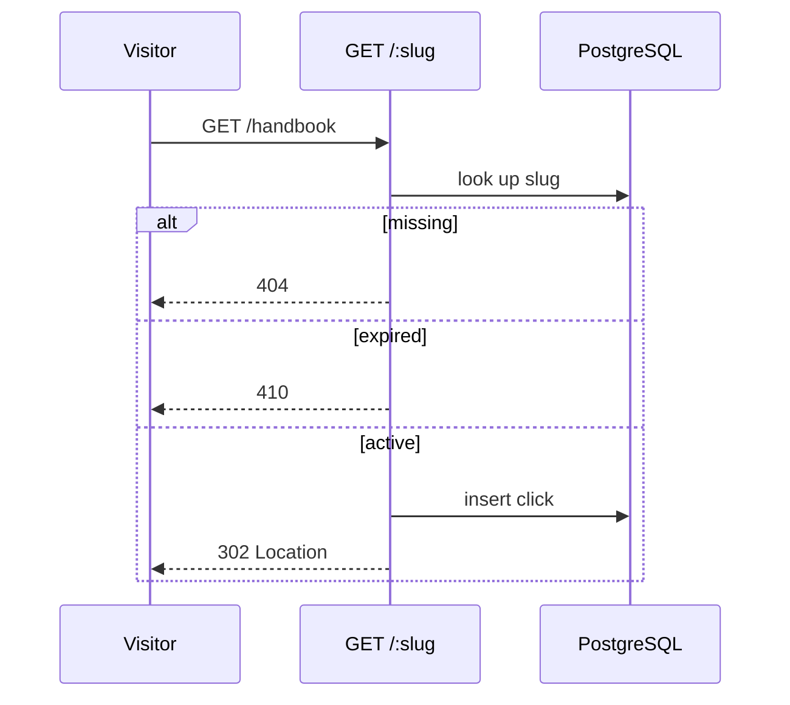

# LinkVault

LinkVault is a small URL shortener. You create a short link, optionally give it an expiry, and every visit is stored. A per-link page then shows daily traffic, referrers, and devices from counts computed in Postgres.

## Features

- Short links with a random slug, or a custom one. Generated slugs are drawn from a 32-character alphabet and inserted under a unique index; a collision just tries another slug.
- Optional expiry. After that moment the redirect handler answers `410` and does not count the visit.
- `GET /:slug` records the visit and answers `302`. The redirect is temporary on purpose: a `301` would be cached by the browser and later visits would never be stored.
- Clicks live in Postgres, indexed by link and by date (`link_id`, `clicked_at`, plus `clicked_at` on its own). The analytics page reads `GROUP BY` results for the day, the referrer host, and the device.
- Each account can create a fixed number of links per window. The counter update sits in a transaction with an advisory lock so two creates for the same account cannot both pass the check.
- Accounts use scrypt password hashes. The session cookie holds a random token; only its SHA-256 hash is stored.

## Architecture



Creating a link:

1. The form posts to `POST /api/links`. Zod checks the URL, the optional slug, and the optional expiry.
2. The handler spends one unit of that account's quota.
3. A custom slug is inserted once. A generated slug is retried if the unique index rejects it.
4. The browser is sent back to the dashboard.

Opening a short link:



The device class comes from a small user-agent check (desktop, mobile, tablet, bot). The referrer is reduced to its hostname, with a leading `www.` removed. A missing referrer is stored as null and shown as Direct.

Daily counts are grouped in SQL by the UTC date. Days with no visits are filled in while rendering, so the chart axis does not skip them.

## Folder structure

```
app/
  [slug]/route.ts          redirect handler
  api/links/route.ts       create and list links
  api/auth/                register, login, logout
  dashboard/               link list and per-link charts
  arrived/                 local stand-in destination
components/                forms, table, SVG and bar charts
lib/                       slug, quota, clicks, analytics, sessions
prisma/                    schema, migrations, seed
tests/unit/                slug, validation, device, quota window
tests/integration/         creation, collisions, quota, aggregation
e2e/                       Playwright coverage of the redirect flow
```

## Running locally

You need Node 22 and Docker.

```bash
cp .env.example .env
docker compose up -d db
npm install
npx prisma migrate deploy
npm run db:seed
npm run dev
```

Open http://localhost:3000. The seed account is `demo@linkvault.local` / `demo-password`. That password only exists so the local database has something to log in with.

`docker compose up` also builds the app container and runs migrations on start. The app listens on port 3000 and talks to the `db` service.

To try a redirect without leaving the machine, shorten `http://127.0.0.1:3000/arrived`.

`RATE_LIMIT_MAX` and `RATE_LIMIT_WINDOW_SECONDS` control the creation window. The defaults are 30 links per hour.

## Tests

Postgres has to be running, with `DATABASE_URL` pointing at it.

```bash
npm test
npm run build
npm run test:e2e
npm run lint
```

`npm test` runs the unit tests, applies migrations, then runs the integration tests against the database in `.env`. Playwright starts its own dev server and covers the redirect: a `302` to the destination, a stored visit on the analytics page, an expired link returning `410`, and the per-account creation limit.

## Design decisions

- **302 and `Cache-Control: no-store`.** Counting visits depends on the request reaching the server every time.
- **Unique index plus retry, not a check-then-insert.** Two requests can draw the same slug. The unique index is what actually serializes them; the retry handles the loser.
- **32-character alphabet.** The low 5 bits of a random byte address it with no modulo bias. Ambiguous characters (`0`, `1`, `l`) are left out.
- **Reserved slugs.** `dashboard`, `login`, `register`, `api`, and `arrived` belong to the app, so they cannot be claimed.
- **Expiry is UTC.** A `datetime-local` value has no zone; the server treats it as UTC and says so on the form.
- **Quota is a fixed window.** The window start is aligned to the clock, and the increment happens under `pg_advisory_xact_lock` for that user. A rejected create does not consume an extra slot past the limit.
- **Aggregation stays in Postgres.** The page draws SVG and CSS bars from those rows. It does not reduce the raw click list in the browser.
- **Session tokens are hashed.** A database read of the `sessions` table is not enough to forge a cookie. The cookie is marked `Secure` when the request arrived over HTTPS (`x-forwarded-proto` or the request URL), so the local Docker setup can stay on plain HTTP.
